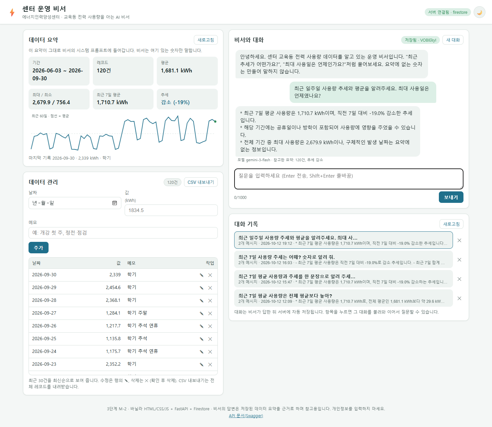
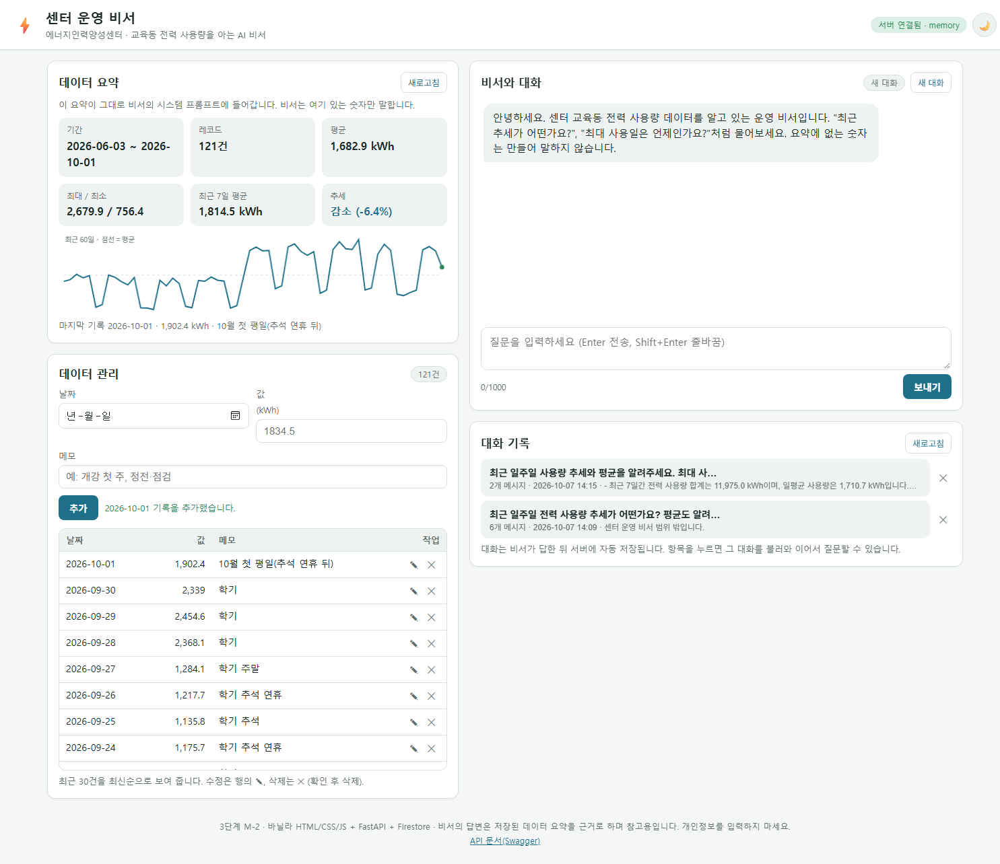
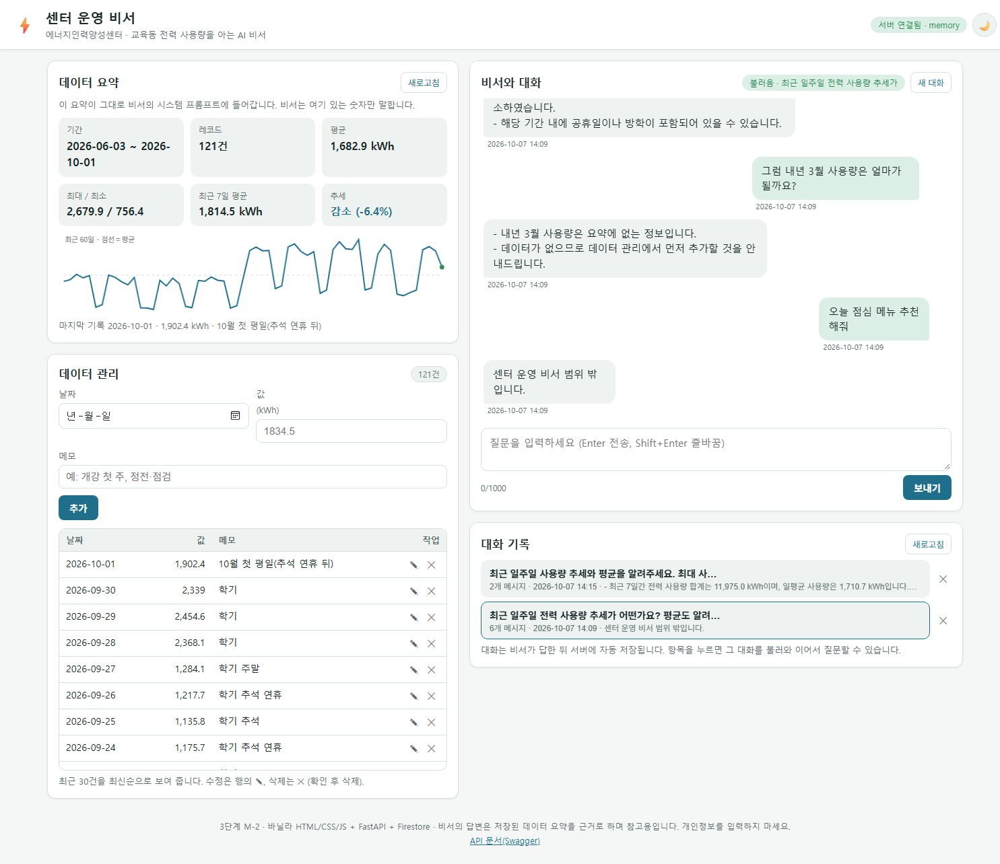

# 센터 운영 비서 — 데이터를 아는 AI 비서 (M-2)

대학교 에너지인력양성센터 교육동의 **일별 전력 사용량**(M-1에서 분석한 데이터)을 저장하고, 그 **요약을 시스템 프롬프트에 주입**해 대화하는 AI 비서 웹서비스입니다.
FastAPI 백엔드(Render) + Firestore + 바닐라 HTML/CSS/JS 프론트(Vercel)로 구성된 3단계 M-2 과제입니다.

| 항목 | 값 |
|---|---|
| 프론트 URL (Vercel) | https://codyssey-m2.vercel.app |
| 백엔드 URL (Render) | https://codyssey-m2.onrender.com |
| Swagger UI | https://codyssey-m2.onrender.com/docs |

> 백엔드는 Firebase 키가 없으면 **memory 저장소**(JSON 파일)로 자동 동작합니다. 채점자가 Firebase 없이도 `uvicorn main:app`만으로 전체 기능을 실행해 볼 수 있습니다.

## 스크린샷 (배포본: Vercel 프론트 + Render 백엔드 + Firestore, 기관 LLM 프록시 연결)

| S-01 요약이 보이는 채팅 질문+답변 | S-02 데이터 추가(CRUD) | S-03 대화 불러오기 |
|---|---|---|
|  |  |  |

S-01에서 비서가 "최근 7일 평균 1,710.7 kWh, 직전 7일 대비 −19.0%"라고 답한 숫자는 왼쪽 요약 카드와 같습니다. "최대 사용일 날짜"는 요약에 없으므로 **"요약에 없는 정보"**라고 답합니다.

## 기능

| 기능 | 화면 | API |
|---|---|---|
| 데이터 기반 AI 채팅 | 오른쪽 "비서와 대화". 로딩 표시, Enter 전송, 1,000자 제한, 오류·타임아웃 안내 | `POST /api/chat` |
| 데이터 요약 | 왼쪽 상단 카드 6개(기간·레코드·평균·최대/최소·최근 7일·추세) + 최근 60일 스파크라인(Canvas) | `GET /api/data/summary` |
| 데이터 관리(CRUD) | 추가 폼, 최근 30건 표, 행의 ✎ 수정(폼에 불러와 PUT), ✕ 삭제(확인), CSV 내보내기(전체 레코드) | `POST/GET/PUT/DELETE /api/data` |
| 대화 기록 | 목록(최근 수정순, 제목·메시지 수·미리보기), 클릭하면 메시지 전체를 불러와 이어서 질문, 삭제 | `GET /api/conversations`, `GET /api/conversations/{id}`, `DELETE` |
| 보너스 | 다크 모드(🌙, localStorage), 스파크라인 그래프, CSV 내보내기(브라우저에서 생성), 요약 추가 지표(최근 7일·변화율·최다 메모·마지막 기록), 서버 상태 배지(저장소 종류·LLM 설정 여부) | `GET /api/health` |

### 컨텍스트 주입 원리

```
POST /api/chat {message, conversation_id?}
  → data_service.get_summary()          # Firestore(또는 memory)의 data 컬렉션 전체 → 요약 dict
  → summary_to_text(summary)            # "[사용자 데이터 요약] 기간 … 레코드 … 평균 … 추세 …" 문장
  → system prompt = 역할·규칙 + 요약 문장
  → LLM(messages = 최근 6턴 + 새 질문)
  → 성공하면 conversations 에 user·assistant 메시지 저장 (프론트는 저장하지 않음 → 중복 없음)
  → {conversation_id, answer, summary_used, model}
```

비서 규칙(시스템 프롬프트): 요약에 있는 수치만 말한다 / 추세는 비교 기준(최근 7일 vs 직전 7일)과 공휴일 주의를 함께 말한다 / 센터 운영과 무관한 질문은 범위 밖이라고 답한다 / 데이터가 없으면 추가하라고 안내한다. 이 규칙은 1단계 B-1 정리봇의 "원문에 없는 내용 추가 금지" 원칙을 그대로 가져왔습니다.

### 설계 이유

- **계층은 "무엇을 아는가"로 나눴습니다.** 라우터(`routers/`)는 HTTP(경로·상태 코드·요청/응답 모델)만, 서비스(`services/`)는 업무 규칙(요약 계산·컨텍스트 주입·저장 시점)만, 저장소(`repositories/`)는 저장 방식만 압니다. memory와 Firestore 구현이 같은 인터페이스라 테스트 17개가 Firebase·LLM 없이 돌고, Firestore로 바꿀 때 코드를 고치지 않았습니다.
- **컬렉션은 문서 하나로 읽히게 했습니다.** `data`는 하루 1건(`date, value, memo, created_at, updated_at`)이고 `date`가 `YYYY-MM-DD` 문자열이라 `order_by("date")`가 곧 시간순입니다. `conversations`는 대화 1건이 문서 1개이고 `messages` 배열에 쌓여, 불러오기와 LLM에 넘길 최근 6개 자르기가 문서 하나로 끝납니다.
- **요약은 한 함수를 같이 씁니다.** 요약 카드, 채팅 컨텍스트, `GET /api/data/summary`가 모두 `data_service.get_summary()`를 부르므로 카드 숫자와 비서가 말하는 숫자가 항상 같습니다. 대신 요약 형식을 바꾸면 세 곳이 함께 바뀝니다.
- **컨텍스트 주입의 장단점.** 요약이 6~7줄이라 토큰이 적고, 질문마다 새로 계산해 데이터 수정이 바로 반영되며, 모델이 볼 수 있는 숫자가 코드로 정해집니다. 반면 요약에 없는 것(예: 최대 사용일 날짜)은 답하지 못하고, 요약 규칙의 약점(연휴가 낀 최근 7일)이 답에 그대로 옮겨 가며, 요약 문장(메모 일부 포함)이 외부 LLM으로 전송됩니다.
- **대화는 답을 받은 뒤 저장합니다.** 질문을 받자마자 저장하면 LLM 오류 때 빈 대화가 쌓이므로, 답을 받은 뒤 서버가 질문·답 2개를 한 번에 저장합니다. 저장은 서버 한 곳에서만 해서 프론트와 중복되지 않습니다.

## 기술 스택

| 구분 | 기술 |
|---|---|
| 백엔드 | Python 3.14, FastAPI 0.142, Uvicorn, Pydantic 2, firebase-admin 7 (Firestore), openai SDK 3 (프록시 `base_url` 교체), python-dotenv, pytest 17개 |
| 저장소 | Firestore 컬렉션 `data`·`conversations` / 로컬·테스트용 memory 저장소(JSON 파일) — `STORAGE` 환경변수로 전환 |
| LLM | 기관 제공 LLM 프록시(OpenAI 호환 Chat Completions), 기본 모델 `gemini-3-flash`. 개인 OpenAI 키도 같은 변수로 동작 |
| 프론트 | HTML/CSS/JS 순수 구현(프레임워크 없음), fetch + AbortController, Canvas 스파크라인, CSS 변수 다크 모드, 반응형 900/600px |
| 배포 | 백엔드 Render Web Service(Free, Singapore, Root Directory `backend`), 프론트 Vercel(Hobby, Root Directory `frontend`), Firestore(서울 `asia-northeast3`) |

## 폴더 구조

```
.
├── backend/
│   ├── main.py                     # FastAPI 앱, CORS, 라우터 등록
│   ├── app/core/     config.py exceptions.py firebase.py
│   ├── app/models/   data.py conversation.py chat.py          # Pydantic
│   ├── app/routers/  health.py data.py conversations.py chat.py
│   ├── app/services/ data_service.py conversation_service.py llm_client.py chat_service.py
│   ├── app/repositories/ base.py memory_repo.py firestore_repo.py
│   ├── scripts/seed_from_m1.py     # 동봉 CSV(또는 M-1 원본) → data 컬렉션 적재
│   ├── data/seed_sample.csv        # M-1 시뮬레이션 데이터 최근 120일 (date,value,memo)
│   ├── tests/test_api.py           # pytest 17개 (LLM mock, memory 저장소)
│   ├── requirements.txt / requirements-lock.txt / .env.example
├── frontend/
│   ├── index.html  css/style.css  js/app.js
│   └── config.example.js           # → config.js (API_BASE_URL)
├── docs/screenshots/
└── README.md
```

## 로컬 실행

### 1. 백엔드 (Firebase 없이, memory 모드)

```
cd backend
python -m venv .venv
.\.venv\Scripts\Activate.ps1
pip install -r requirements.txt
copy .env.example .env                 # OPENAI_API_KEY 만 채우면 채팅까지 동작. 비우면 채팅만 503(LLM 미설정) 안내
python scripts/seed_from_m1.py         # (선택) 동봉 CSV(M-1 데이터 120일) 적재. 이 저장소만 clone 해도 됨
uvicorn main:app --reload --port 8000  # Swagger: http://localhost:8000/docs
python -m pytest tests -q              # 17 passed
```

### 2. 프론트

```
cd frontend
copy config.example.js config.js       # API_BASE_URL = http://localhost:8000
python -m http.server 5500             # http://localhost:5500
```

### 3. Firestore 모드로 전환

`.env`에 `STORAGE=firestore`와 Firebase 변수(아래)를 넣고 백엔드를 다시 시작합니다. 코드 수정은 없습니다.

## 환경 변수

| 이름 | 어디에 | 설명 |
|---|---|---|
| `STORAGE` | 백엔드 | `memory`(기본) 또는 `firestore` |
| `OPENAI_API_KEY` (또는 `CODYSSEY_API_KEY`) | 백엔드 | LLM 키. 기관 프록시 키 또는 개인 OpenAI 키 |
| `OPENAI_BASE_URL` (또는 `CODYSSEY_BASE_URL`) | 백엔드 | 프록시 주소(`https://copa.codyssey.kr`). 비우면 OpenAI 기본 |
| `LLM_MODEL` | 백엔드 | 기본 `gemini-3-flash` |
| `LLM_TIMEOUT` | 백엔드 | LLM 호출 제한 시간(초), 기본 20 |
| `FIREBASE_SERVICE_ACCOUNT_JSON` **또는** `FIREBASE_PROJECT_ID`·`FIREBASE_CLIENT_EMAIL`·`FIREBASE_PRIVATE_KEY` | 백엔드 | 서비스 계정 키. `FIREBASE_SERVICE_ACCOUNT_JSON`은 키 JSON 파일 경로(또는 JSON 문자열). 이 배포는 Render **Secret File** `firebase-key.json` → 경로 `/etc/secrets/firebase-key.json`. 3개 변수 방식도 동작(`PRIVATE_KEY` 줄바꿈은 `\n`) |
| `ALLOWED_ORIGINS` | 백엔드 | 프론트 주소(쉼표 구분). `*.vercel.app`은 정규식으로 항상 허용 |
| `DATA_LABEL`, `DATA_UNIT` | 백엔드 | 요약 카드·프롬프트에 표시되는 데이터 이름·단위 |
| `API_BASE_URL` | 프론트 `config.js` | 백엔드 주소 |

키는 코드·README·캡처에 쓰지 않습니다. `.env`, `config.js`, 서비스 계정 JSON은 `.gitignore`에 있습니다.

## 배포 절차 (GitHub → Render + Vercel)

1. **Firebase**: 콘솔 → 프로젝트 추가 → Firestore Database 만들기(리전 asia-northeast3) → 프로젝트 설정 › 서비스 계정 › 새 비공개 키 생성. 보안 규칙은 클라이언트 접근 전부 거부(백엔드 Admin SDK만 접근).
2. **Render**: New Web Service → **Public Git Repository**에 이 저장소 주소(GitHub 앱 권한 없이 연결) → Root Directory `backend`, Build `pip install -r requirements.txt`, Start `uvicorn main:app --host 0.0.0.0 --port $PORT`, Health Check Path `/api/health`, Free. 환경변수에 `STORAGE=firestore`, `OPENAI_API_KEY`, `OPENAI_BASE_URL`, `FIREBASE_SERVICE_ACCOUNT_JSON=/etc/secrets/firebase-key.json`, `ALLOWED_ORIGINS=https://<프론트>.vercel.app`. **Secret Files**에 `firebase-key.json`(서비스 계정 키 JSON 전체)을 붙여 넣습니다. 배포 후 `/api/health`(`storage: firestore`)와 `/docs` 확인. Python은 Render 기본값(3.14)으로 빌드됩니다.
   - 공개 저장소 주소로 연결하면 push 뒤 자동 재배포가 되지 않을 수 있습니다. 백엔드를 고쳤거나 환경 변수를 "Save only"로 저장했으면 **Manual Deploy → Deploy latest commit**으로 다시 배포합니다.
   - 무료 티어는 15분 미사용 시 잠들고 첫 요청에 최대 50초 걸립니다. 프론트는 채팅 타임아웃을 50초로 잡고 상단 배지로 상태를 보여 줍니다. 서버 응답이 2.5초 넘게 없으면 배지가 "무료 서버 깨우는 중… 최대 약 50초"로 바뀌어 기다리는 이유를 알려 줍니다.
3. **Vercel**: GitHub의 Vercel 앱에 이 저장소 접근을 허용 → Add New Project → 같은 저장소 → Root Directory `frontend`, Framework Other, **Output Directory `.`**(Override를 켜고 점 하나 — 비워 두면 `public` 폴더를 찾다가 "No Output Directory named 'public'"으로 실패). 환경 변수 `API_BASE_URL=https://<백엔드>.onrender.com`을 등록하고, `config.js`는 커밋하지 않으므로 Build Command에 아래를 넣어 빌드 때 환경 변수로 만듭니다.
   ```
   echo "window.APP_CONFIG={API_BASE_URL:'$API_BASE_URL',REQUEST_TIMEOUT_MS:25000}" > config.js
   ```
   (대안: 배포 전에 `config.js`를 만들어 커밋 제외를 해제.) 이후 main에 push하면 Vercel이 자동으로 다시 배포합니다.
4. 프론트 URL에서 채팅·CRUD·대화 불러오기 확인 → 스크린샷 3장 → 이 README 상단 URL 3개 기록.

## 테스트

`backend/tests/test_api.py` 17개: 데이터 CRUD·검증(400)·404, `/summary`가 `/{id}`에 가려지지 않음, summary 계산(빈 데이터·증가·감소·유지), 요약 문장, 대화 CRUD, 챗이 대화를 만들고 메시지 2개를 저장, 이어가기(이전 턴 전달), 빈 메시지 400·없는 대화 404, LLM 키 없음 503(빈 대화를 남기지 않음), 시스템 프롬프트 규칙 포함. LLM과 Firestore는 mock·memory로 대체해 외부 서비스 없이 돌아갑니다.

## 한계·운영 메모

- 비서는 **요약**만 알고 개별 레코드는 모릅니다("최대 사용일 날짜"에 답하지 못함). 보너스로 Function Calling(요약·레코드 조회 도구)을 붙이면 해결되며, 프록시의 `tools` 지원 여부 확인이 선행돼야 합니다.
- 추세 규칙(최근 7일 vs 직전 7일 ±5%)은 공휴일·방학을 모릅니다. 프롬프트에서 주의 문구를 강제했습니다.
- 과금·쿼터: `max_tokens`는 사고 토큰 문제로 생략했지만 입력 1,000자 제한, 이전 대화 6턴만 전달, 재시도 1회로 호출량을 제한합니다.
- 입력은 저장되지만(대화 기록 기능) 개인정보 입력 금지 문구를 두었고, 서버 로그에는 본문을 남기지 않습니다.
